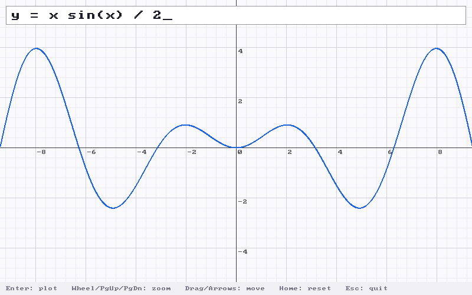

# Graph Plotter

A small function plotter written in C++ with SDL3. Type an equation in x, press Enter, and it is parsed and drawn. You can zoom and move around the graph freely.



## Build and run

You need a C++17 compiler, make, pkg-config and the SDL3 development package.

```
make
./plot              # starts with sin(x)
./plot "x^2 - 3"    # starts with your own equation
```

## Equations

Use `+ - * / ^`, brackets, `pi`, `e` and the functions `sin cos tan asin acos atan sinh cosh tanh sqrt abs exp ln log floor ceil`. You can leave out `*`, so `2x`, `3(x+1)` and `x sin(x)` all work. A leading `y =` is optional.

## Controls

Type to edit the equation and press Enter to plot it. Use the mouse wheel or PageUp/PageDown to zoom, drag with the left mouse button or use the arrow keys to move, press Home to reset the view and Esc to quit.
